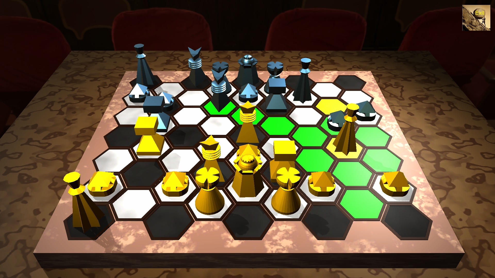

# Intellector

Приложение для игры в интеллектор.

## Скачать последнюю версию приложения

- [Windows](https://github.com/NikanorovVD/Intellector/releases/download/v1.7.0/Intellector_v1.7.0_windows.zip)
- [Android](https://github.com/NikanorovVD/Intellector/releases/download/v1.7.0/Intellector_v1.7.0_android.apk)

## Ссылки

- [Официальный сайт Intellector](https://intellector.info/)
- [Правила игры](docs/rules.pdf)

## Основные функции

- Игра против ИИ
- Сетевая игра
- Игра на одном устройстве
- Контроль времени
- История партий
- Компьютерный анализ партий

## Технологии

- Unity 2022.3.10f1
